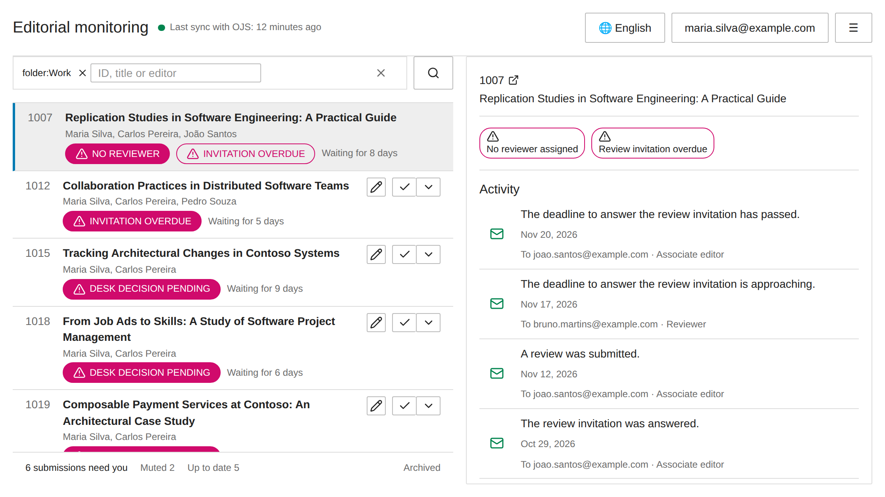
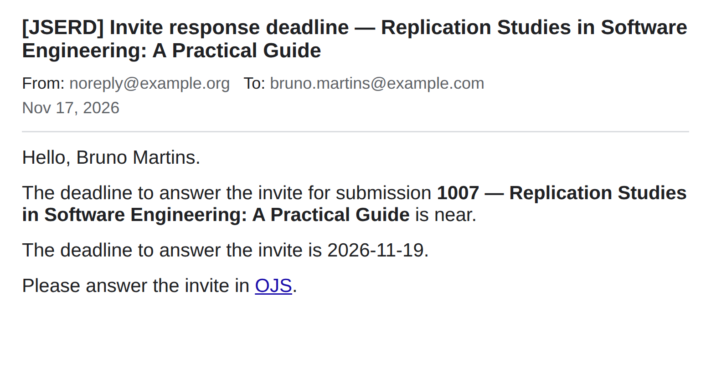
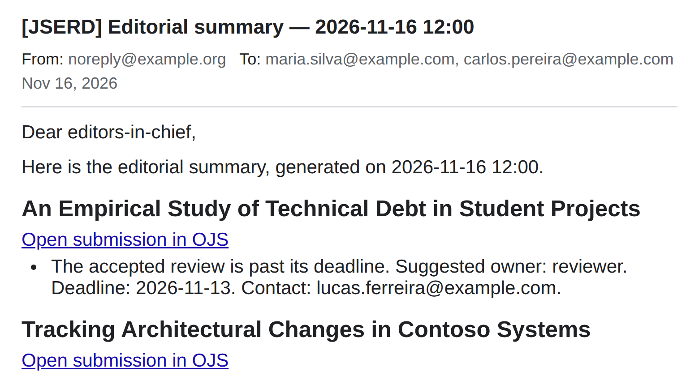

# JSERD Monitoring: An External Tool for Editorial Oversight in OJS

The Brazilian Computer Society (SBC) publishes the Journal of Software
Engineering Research and Development (JSERD), which uses Open Journal Systems
(OJS) 3.2.1. This version of OJS has limitations that make it hard
for the chief editors to monitor the submissions. To support the chief
editors in this task, and to alert editors and reviewers so that the review
process moves faster, this work developed JSERD Monitoring, a tool external
to OJS. The tool collects data from OJS at regular intervals, detects events
and deadlines, sends email notifications to editors and reviewers, and shows
the chief editors the submissions that need attention. This paper presents
the requirements, the architecture, and the features of the tool.

## Paper

The paper "JSERD Monitoring: An External Tool for Editorial Oversight in OJS"
presents the requirements, the architecture, and the features of the tool:
[`sbc-jheam-ross.pdf`](PGs/2026_2_SBC_Jheam_Ross/sbc-jheam-ross.pdf).

## Specification

This section is the specification of JSERD Monitoring. It uses the same
IDs as the paper (`FR`, `NFR`, and `R`).

### Users

- **Chief editors** use the dashboard. They receive the weekly editorial
  summary and the notification of R16. In OJS, their role is *journal editor*.
- **Assigned editors** receive the notifications of R1 to R5. In OJS, their
  role is *associate editor*.
- **Reviewers** receive the notifications of R6 to R8.

### Requirements

The requirements are in Table 1, in [Section 3.1 of the paper](PGs/2026_2_SBC_Jheam_Ross/sbc-jheam-ross.pdf).

### Monitoring rules

The monitoring rules are in Table 2, in [Section 3.2 of the paper](PGs/2026_2_SBC_Jheam_Ross/sbc-jheam-ross.pdf).

### Finding kinds

The tool has ten finding kinds. The table lists them from the most severe to
the least severe. The work list sorts the submissions by their most severe
finding.

| Rank | Rule | Finding kind (code) | Work list badge | Detail view label |
| --- | --- | --- | --- | --- |
| 1 | R12 | `missing_editor` | No editor | No editor assigned |
| 2 | R16 | `missing_copyeditor` | No copyeditor | No copyeditor assigned |
| 3 | None | `unsent_review_completion` | Result not sent | Review completion not sent |
| 4 | R13 | `reviews_complete_no_decision` | No decision | Reviews complete, no decision |
| 5 | R14 | `revision_pending_decision` | Revision received | Revised version received, no decision |
| 6 | R11 | `missing_revision_indication` | Revision missing | Revised version missing |
| 7 | R10 | `overdue_review` | Review overdue | Overdue review |
| 8 | R9 | `missing_reviewer` | No reviewer | No reviewer assigned |
| 9 | R17 | `overdue_review_invitation` | Invitation overdue | Review invitation overdue |
| 10 | R15 | `awaiting_desk_decision` | Desk decision pending | Awaiting desk decision |

The finding kinds are declared in
[`src/server/internal/editorial/catalog.go`](src/server/internal/editorial/catalog.go).
The labels are in
[`src/client/messages/en.json`](src/client/messages/en.json) and
[`src/client/messages/pt-BR.json`](src/client/messages/pt-BR.json).

### Queues

The queues are in [Section 4 of the paper](PGs/2026_2_SBC_Jheam_Ross/sbc-jheam-ross.pdf#page=7).

### Emails

| Email | Recipient | Template |
| --- | --- | --- |
| R1 to R5 | Assigned editor | [`rn1.tmpl`](src/server/internal/email/templates/rn1.tmpl) to [`rn5.tmpl`](src/server/internal/email/templates/rn5.tmpl) |
| R6 to R8 | Reviewer | [`rn6.tmpl`](src/server/internal/email/templates/rn6.tmpl) to [`rn8.tmpl`](src/server/internal/email/templates/rn8.tmpl) |
| R16 | Chief editors | [`rn18.tmpl`](src/server/internal/email/templates/rn18.tmpl) |
| Welcome email | Each recipient, once | [`welcome.tmpl`](src/server/internal/email/templates/welcome.tmpl) |
| Editorial summary | Chief editors | [`summary.tmpl`](src/server/internal/editorial/templates/summary.tmpl) |

### Default values

| Value | Default | Where to change it |
| --- | --- | --- |
| Collection cycle | Every hour | `OJS_COLLECTION_CRON` |
| Email worker | Every minute | `EMAIL_WORKER_CRON` |
| Editorial summary | Every Monday at 09:00 | `SUMMARY_CRON` |
| Time zone of the schedules | `America/Sao_Paulo` | `EDITORIAL_TIMEZONE` |
| Wait after a revision request (R11, R14) | Seven days | `EDITORIAL_RN11_FALLBACK_DAYS` |
| Active reviewers per round (R9, R17) | Two | Hardcoded |

The [Configuration reference](#configuration-reference) lists every configuration variable.

## Screenshots

All data in the screenshots are fictitious.

The dashboard, with the work list on the left and the detail view of one
submission on the right:



A reminder to a reviewer (R6):



The weekly editorial summary to the chief editors:



## Repository layout

| Path | Content |
| --- | --- |
| `src/server/` | The server: a Go program that extends PocketBase. |
| `src/client/` | The dashboard: a static Next.js application. |
| `docs/` | The deployment guide. |
| `deploy/`, `scripts/` | The files and scripts for the deployment. |
| `PGs/` | The paper and the first submission of the work. |


## Server setup

### Prerequisites

- `Go 1.26.4`

### Environment file

The server requires `src/server/.env` to exist, but it does not parse the file
itself. For a local process, copy the example, restrict access to the current
user, and export its values before starting the server:

```sh
cd src/server
cp .env.example .env
chmod 600 .env

set -a
source ./.env
set +a

go run . serve
```

The default configuration uses local fixtures and the test e-mail transport.
The report exports in `data/examples/` are local, ignored files and are not
included in a fresh checkout. Fixture mode needs these files; tests use
synthetic inputs. Keep real editorial exports out of version control.
It does not contact an OJS or SMTP server. After startup, access:

- API: <http://127.0.0.1:8090/api/>
- PocketBase Admin: <http://127.0.0.1:8090/_/>

On the first run, use the `pbinstall` URL printed by the server to create the
PocketBase superuser.

### Configuration reference

| Variable | Default/example | Purpose |
| --- | --- | --- |
| `ALLOW_TEST_DELIVERY` | `true` | Permits the intercepting e-mail transport. `false` rejects `DELIVERY_MODE=test`. |
| `OJS_SOURCE_MODE` | `fixtures` | Collection source: `fixtures` or `live`. |
| `OJS_BASE_URL` | `http://127.0.0.1` | OJS installation root. Live mode requires an HTTP(S) URL, commonly ending in `/index.php`. |
| `OJS_JOURNAL_CONTEXT` | `jserd` | Journal path/context used below the OJS installation root. |
| `OJS_USERNAME` | empty | OJS account used for form login in live mode. |
| `OJS_PASSWORD` | empty | OJS account password used in live mode. |
| `OJS_REQUEST_TIMEOUT_SECONDS` | `30` | Positive timeout for each OJS HTTP request. |
| `OJS_FIXTURES_DIR` | `../../data/examples` | Directory containing the three fixture CSV files. Required in fixture mode. |
| `OJS_ARTIFACT_ROOT` | `pb_data/collector_runs` | Private directory where downloaded CSV and JSON artifacts are retained. |
| `DELIVERY_MODE` | `test` | E-mail transport: `test` intercepts messages; `smtp` sends them. |
| `SMTP_HOST` | empty | SMTP host. Required only in SMTP mode. |
| `SMTP_PORT` | `0` | SMTP port. Must be between 1 and 65535 in SMTP mode. |
| `SMTP_USERNAME` | empty | Optional SMTP username. Must be configured together with `SMTP_PASSWORD`. |
| `SMTP_PASSWORD` | empty | Optional SMTP password. Must be configured together with `SMTP_USERNAME`. |
| `SMTP_TLS` | `false` | Enables SMTP TLS. Required for every non-loopback SMTP host. |
| `SMTP_FROM_ADDRESS` | `JSERD Development <noreply@example.test>` | Required and validated sender address in both delivery modes. |
| `SMTP_REPLY_TO` | empty | Optional reply-to address used for editor notifications. |
| `OJS_COLLECTION_CRON` | `0 * * * *` | Five-field cron expression for OJS collection. |
| `EMAIL_WORKER_CRON` | `* * * * *` | Five-field cron expression for processing pending individual e-mails. |
| `SUMMARY_CRON` | `0 9 * * 1` | Five-field cron expression for the editorial summary e-mail schedule. |
| `EDITORIAL_TIMEZONE` | `America/Sao_Paulo` | IANA timezone used by scheduled jobs. |
| `EDITORIAL_RN11_FALLBACK_DAYS` | `7` | Positive fallback deadline, in days, for RN11 when OJS has no explicit deadline. |
| `OJS_CHIEF_EDITOR_GROUP_ID` | empty | Optional exact OJS group ID used to resolve chief editors. |
| `OJS_CHIEF_EDITOR_GROUP_NAME` | empty | Optional exact OJS group name used to resolve chief editors. |

## Dashboard setup

The dashboard needs Node.js and pnpm. Build the static export and copy it to
the server:

```sh
cd src/client
pnpm install
pnpm build
pnpm publish:pb
```

`pnpm publish:pb` copies the static export to `src/server/pb_public/`. The
server then serves the dashboard at <http://127.0.0.1:8090/>. To sign in,
create a record in the `chief_editors` collection in the PocketBase Admin.

## Pre-commit checks

A [Lefthook](https://github.com/evilmartians/lefthook) pre-commit hook, defined in
[`lefthook.yml`](lefthook.yml), runs on every commit that touches server or
client files:

- Server: `golangci-lint` fails the commit if a function's cyclomatic
  complexity exceeds 10 (see `src/server/.golangci.yml`). `go test ./... -cover`
  runs and prints coverage per package; it fails the commit only if a test
  fails, not because of the coverage number itself.
- Client: `biome lint` fails the commit if a function's cognitive complexity
  exceeds 15 (see `src/client/biome.json`). `vitest run --coverage` runs and
  prints coverage per file; it fails the commit only if a test fails, not
  because of the coverage number itself.

### Install

```sh
go install github.com/evilmartians/lefthook@v1.11.13
go install github.com/golangci/golangci-lint/v2/cmd/golangci-lint@latest
lefthook install
```

## Deployment

Deployment to the production VM is documented separately, in
[`docs/deployment.md`](docs/deployment.md). It covers the one-command deploy,
rollback, backups, and first-time VM setup.

## License

The source code is under the MIT License. See [`LICENSE`](LICENSE).
